-- Day 1  [2026/10/13]
My exams are going on and i decided to design a keyboard from scratch *🙂*. 
Anyways, since i decided to design a keyboard with 0 experience on designing anything this should be fun 
So first i learnt about kicad a software suite which is the one ill be using to design the keyboard.

Before designing the keyboard first gotta learn how a keyboard even works found this great [video](https://www.youtube.com/watch?v=h-NM1xSSzHQ) by branch education 
explaining how a keyboard works.
Now i gotta decide on a layout of the keyboard before actually designing it i found this really pretty layout in r/keyboards. 
I looked in google and its apparently called a 75% keyboard

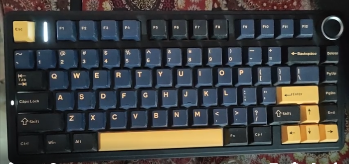

Well lets call it a day for today

-- Day 2 [2026/10/14]

I am failing my physics and its chemistry tommorow and i am failing that too! *🙂*
So before deciding on anything lets decide on the microcontroller. Since i want the keyboard to be a hybrid keyboard meaning it supports both bluetooth and usb
i need to find a microcontroller which will easily lets me do that.I found this [board](https://nicekeyboards.com/nice-nano/) it has both USB-C and bluetooth 
support and it has enoguh [GPIO pins](https://nicekeyboards.com/docs/nice-nano/pinout-schematic/) for my keyboard matrix.

So i decided to use the nice nano as the controller board. After one huge pain in the ass for some reason was i couldnt find the symbol and footprint for the nice!nano. 
I thought to myself ill just use github how hard could it be. I found this [repo](https://github.com/bstiq/nice-nano-kicad) just from a simple search and it looked liked 
the thing i needed i downloaded it and when i tried to import the symbol into kicad for some reason kicad decided that only .kicad_sym were allowed to be imported as symbol 
libraries so i spent like 30 mins trying to import it but i couldnt do it. Eventually i decided to look at the split keyboard guide hoping ill find something useful there 
and i did! I found this [repo](https://github.com/ebastler/marbastlib/) and it had the nice!nano symbol and footprint. 

After that it was pretty easy to setup i decided to call it a day cuz i need to study for chemistry and all. 

Now i really want a OLED display for this keyboard too so i decided to just use the built in oled display symbol in kicad 

-- Day 3 [2026/10/16]
Good news my exams are finished less gooo anyways so i did nothing on the 15th. 
So today i decided to finally start building the schematic took me some time but i managed to do it currently the keyboard has a 6x10 matrix
with an oled display. 
here's the final result in all its glory

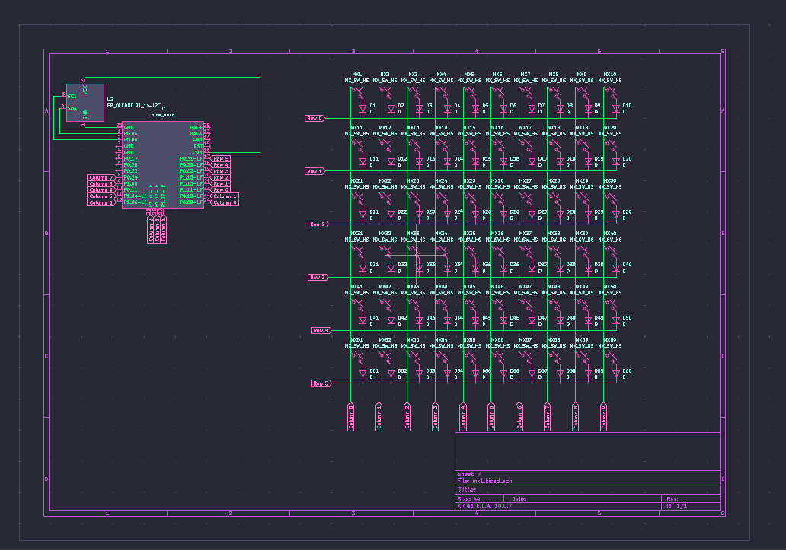

For the footprints of the components i used the default thing they give for the nice!nanov2 in marbastlib and for the keyboards 
i used the SW_Cherry_MX_PCB_1.00u from the Keyswitch library finally for the diodes i used the SOD-123. 

-- Day 4 [2026/10/17]
Today decided to wire up the pcb and everything and god i hate placing diodes  
probably took me an hour to just place the diodes in the correct position.

When wiring everything up i decided to wire the rows on the B.cu and the columns on the F.cu
Now after everything here is my final pcb in all its glory!!.

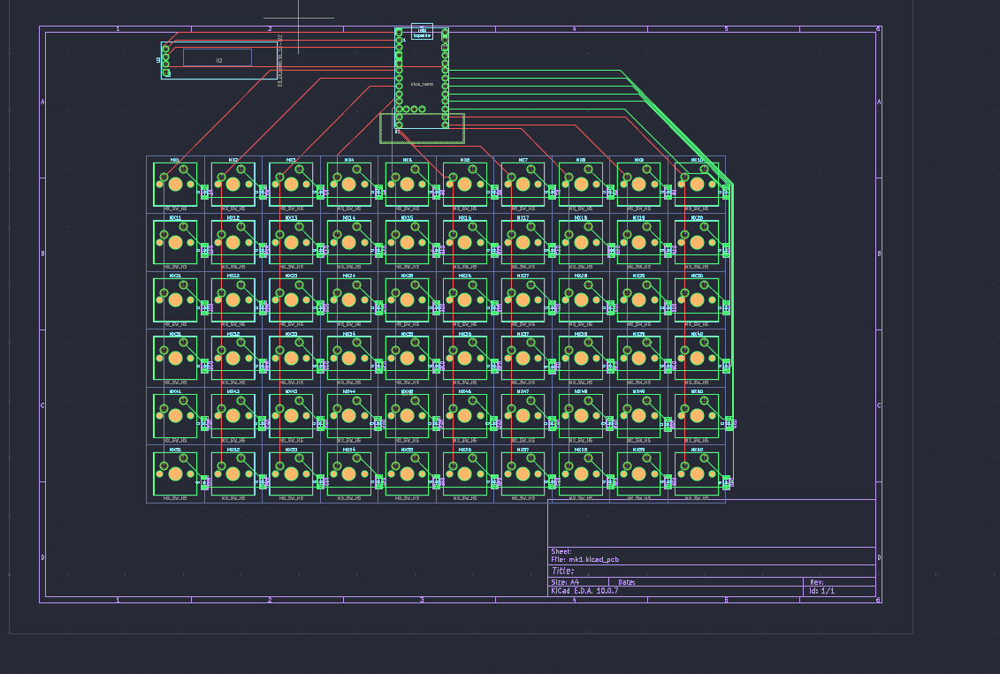
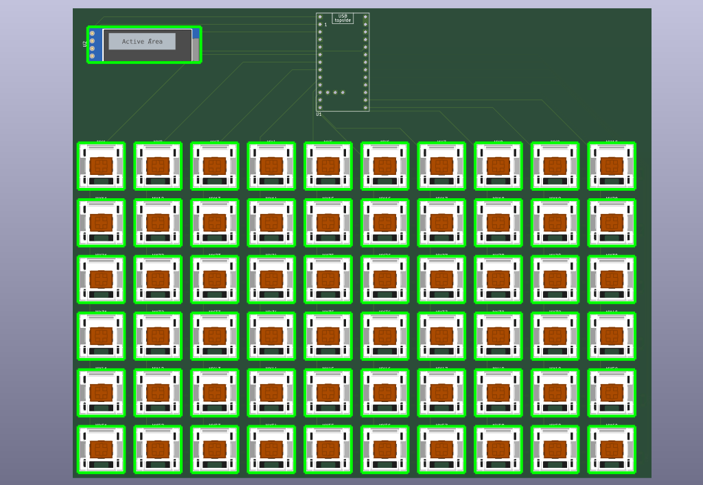

Ok i ran the DRC and kicad is throwing a fit.
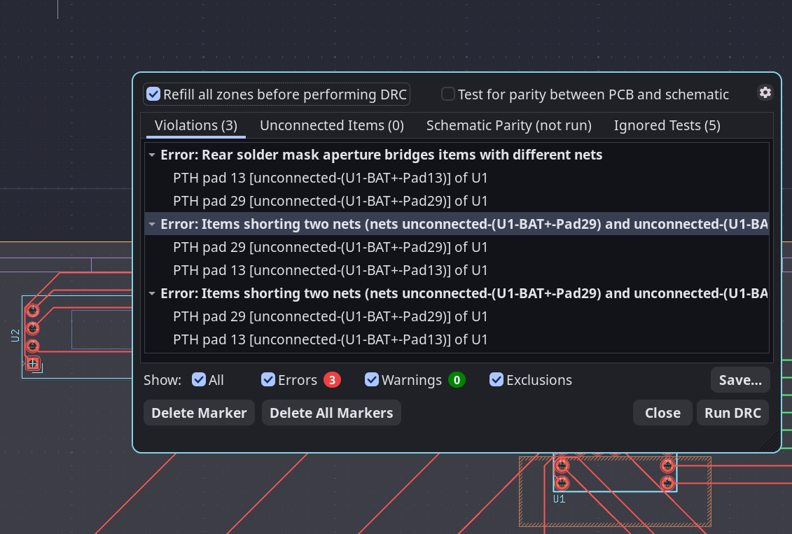

i dont really get why it threw that error my best guess is that in the footprint it looks like the 2 battery
pins are like connceted and kicad saw that in the footprint and since the uk 2 different pins connecting with each other 
is like a short circit so it threw that error 

I managed to fix it by connecting the 2 pins and adding a no-connect flag in the schematic 
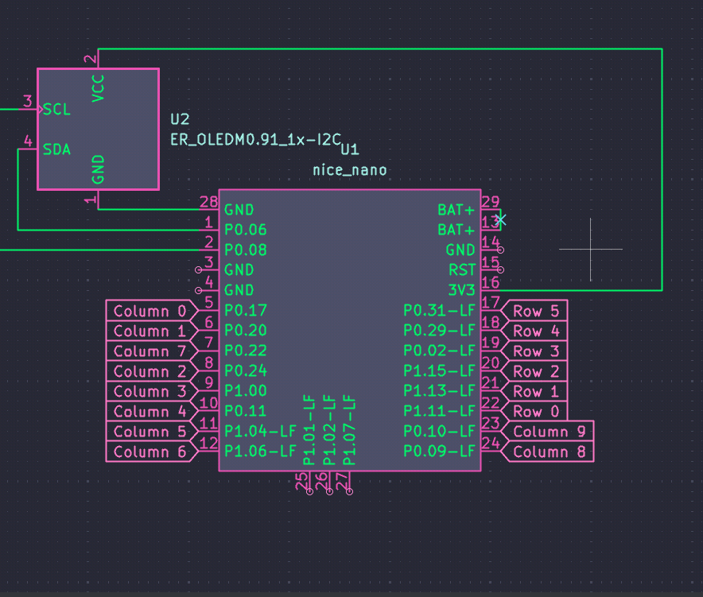

ok sooo i have an itch to redesign this entire schematic and pcb again
I ditched the nice!nano cuz the GPIO pins were not enoguh ill be using a raspberry pi pico W now 

So its been like a while now i finally finished my redesigning the pcb and the schematic but i have a question 
the ratnest lines are telling me to connect all the ground of the pi pico together i wonder why it is telling me to do that
I'll look into it later its like 23:00 right now and i am feeling sleepy asf i think this will be it for today

-- Day 5 [2026/10/18]
I still dont fully get it but my best guess right now based on what ive read is that the GND in the electrical diagrams 
most of the time represents a 0 volt a sort of reference point from which all other positive or negative voltages in the circuit are measured

Ok so i was wondering if the GND pins must be connected why doesnt the pico connect the GND pins internally in its PCB turns
out it actually does!! but if we solely rely on the pico's internal wiring to connect the GND then a high enough current can cause the 
voltage to become unstable so using a copper fill is best practice for builds. 

Also i added like a button to short the RUN pin low at the side it bascially resets the pico

-- Day 6 [2026/10/19]
its currently the holiday season in my country im was out with my family so i did basically nothing today 

-- Day 7 [2026/10/20]
ok so i finished the schematic and the pcb well technically not i still have to connect the USB C connections and what not
but uk ill do that later its just a few connections how hard could it be right?

so i researched some tools for 3d modeling my keyboard found 3 
 - Fusion360
 - FreeCAD
 - Blender

I looked online and saw that blender while its great at making organic shapes its really bad for adjusting things like case walls 
screw holes etc while it can be done with other plugins its just feels hacky to me so i decided to not go with blender 

The next option Fusion360 it looked great on paper i saw the personal version had a lot of limitations while it probably wouldn't 
have affected me all that much i didnt use it just cuz i didnt wanna use something proprietery if i a open source alternative 
which people were praising too so i decided to go with FreeCAD. 

Btw [this](https://www.youtube.com/watch?v=KmtqNaGPiiQ) starting tutorial for FreeCAD is awesome for starting out it really helped me

-- Day 8 [2026/10/21]
I realized that i am a caveman atp like making this 3D model should not be this hard i am here sitting on my ass since probably for like 5 hrs now and i still havent finished this 
model.

Although i dont like to admit it i spent way too much time on trying to figure out the screw holes
I am currently making the upper cover right now here is the progress so far i still need to cut the space in the cover plate for the switches 
but its nearing completion i hope so because i donot like making 3D models at all this project has been teaching me alot of things but the most 
important thing it taught me is that making 3D models is not my thing my brain isn't built for ts but still i managed to piece this together somehow 

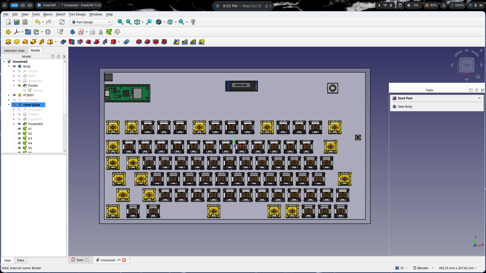
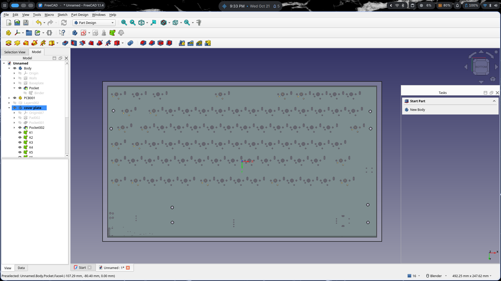

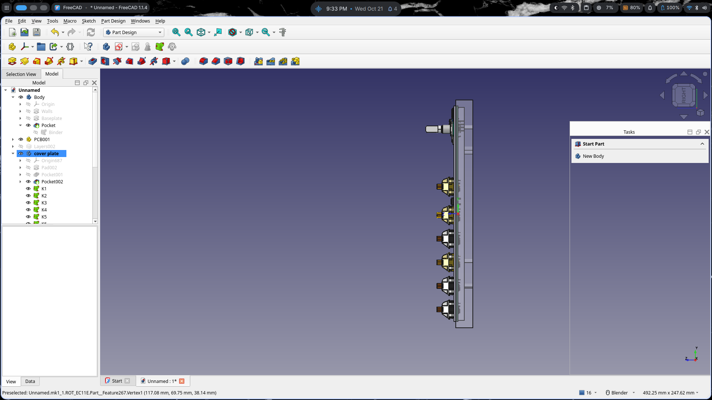

-- Day 9 [2026/10/22]
Not a lot today did manage to finish the cover plate nothing else much 

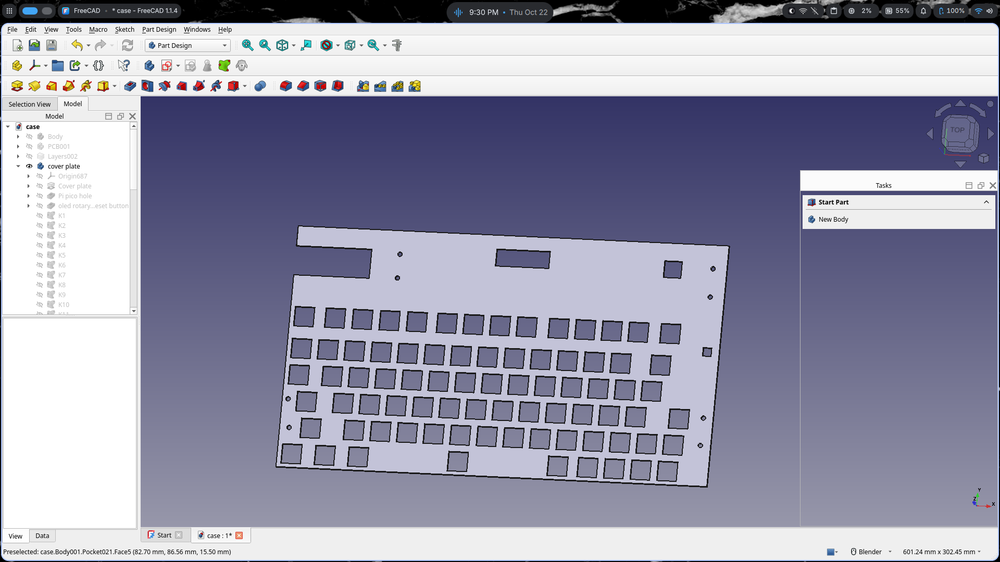

but there is still one question bugging me like there are no threads in the holes for the screws to screw into even more i designed the screws so that they go through the cover plate
the entire board including the cover plate is about 15.5 mm so i looked it up and the screws are generally this long so ig my worry on that part is gone 
also like what do i do about the threads tho?

ok i see people saying that using a heated insert is better than 3d printing the threads themselves if you want the screws to be long lasting 
so i am looking into the heat inserts

just watched a [video](https://www.youtube.com/watch?v=M4QZzg8q7-U) they seem pretty handy i can probably just use a soldering iron instead of that 
heat inserter tool thingy and they seem easy enough to install so i think ill be going with the heated inserts
the holes used in the case and the pcb are M3 3.2mm holes so i dont think ill need to make any changes to the case i dont need to make changes to the cover plate 
holes but the holes in the base need to be increased to around 4.7 mm to fit the inserts

ok so now theres some final touches i need to do in the model like adding stabilizers and the keycaps ill do that later tmrw

-- Day 10[2026/10/23]

I am hoping that today i'll finish the 3d model and the firmware 
but before that there is one more thing thats been bugging me in the pcb 
THERE ARENT ANY GRAPHICS !!!!!

I really want the pcb to look cool this project's main inspiration was the [brew-keeb](https://github.com/geg-tech/brew-keeb) and the pcb that he has is so 
cool i want something like that in my pcb too!! ill talk more about why i made this project and the design inspirations in the README.md

heres kinda the sketch i came up with for the graphics
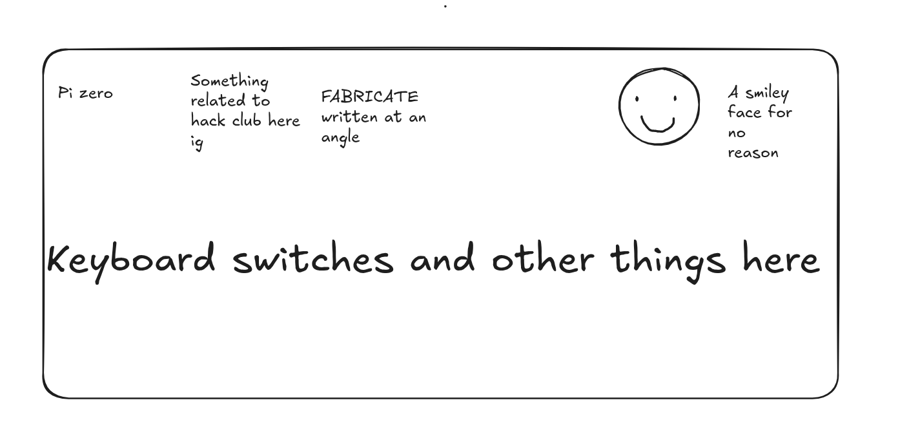

im not good with these things so dont judge me plz
heres the pcb

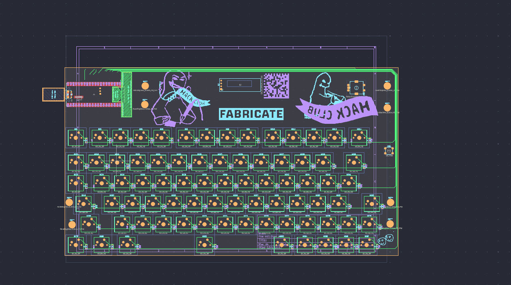
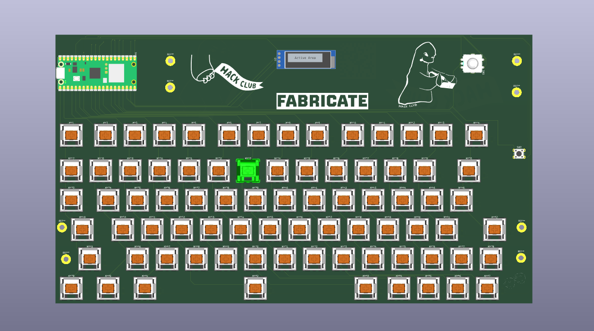
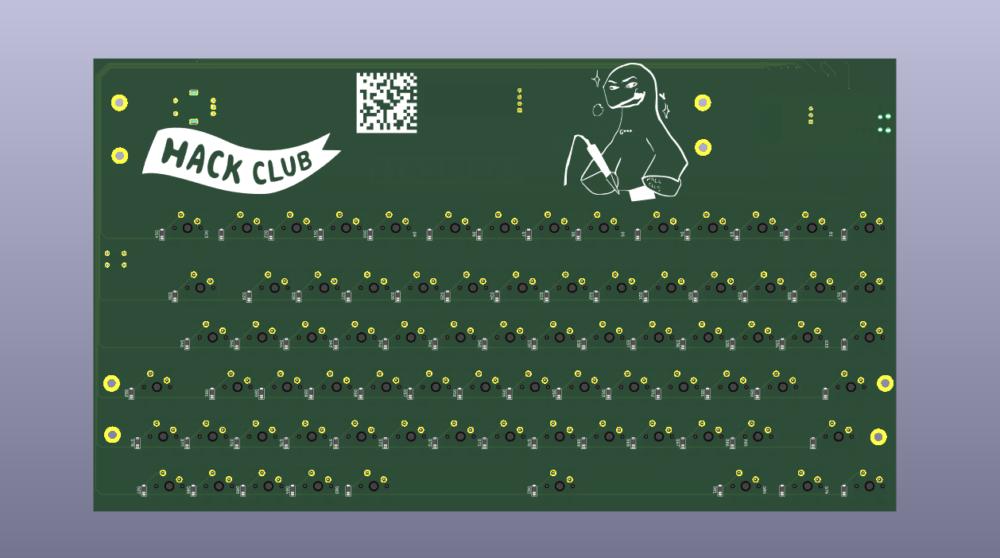

Now moving on to the stabilizers there are essentially 2 main types of keyboard stabilizers:
- Costar stabilizers
- Cherry stabilizers

Costar stabilizers look like this 
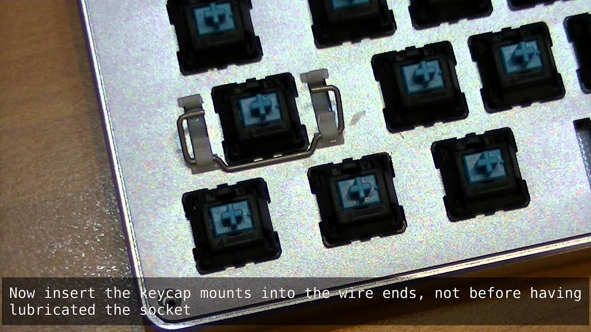

they basically have thin metal wires and hooks at the end to stabilize the key.

cherry stabilizers look like this 
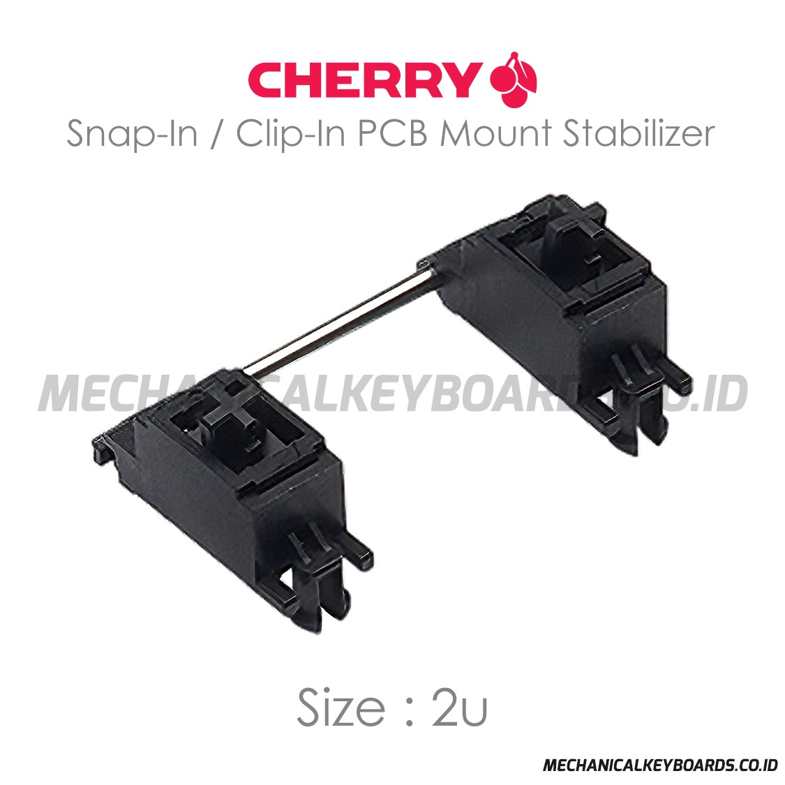

basically the main principle is the same but the metal wire is also connected to dummy switches at the end 
these dummy switches move freely up and down 

i decided to go with the cherry stabilizers they just make removing the keycaps easier than the costar options 

im just adding the holes for the stabilizers in the model and i searched up vids to see how these stabilizers will actually go on the cover 
and i found this [video](https://youtu.be/a173Blgfmww) in this video the switches are like like too far from the pcb than compared to my design and it turns out i am actually 
supposed to leave a gap of around 5mm between the cover plate i dont fully get why but im pretty sure it has to do something with the retention clips not being able to snap 
properly ig. 

ok heres the plate with holes for the stabilizers still not too sure if this is correct 
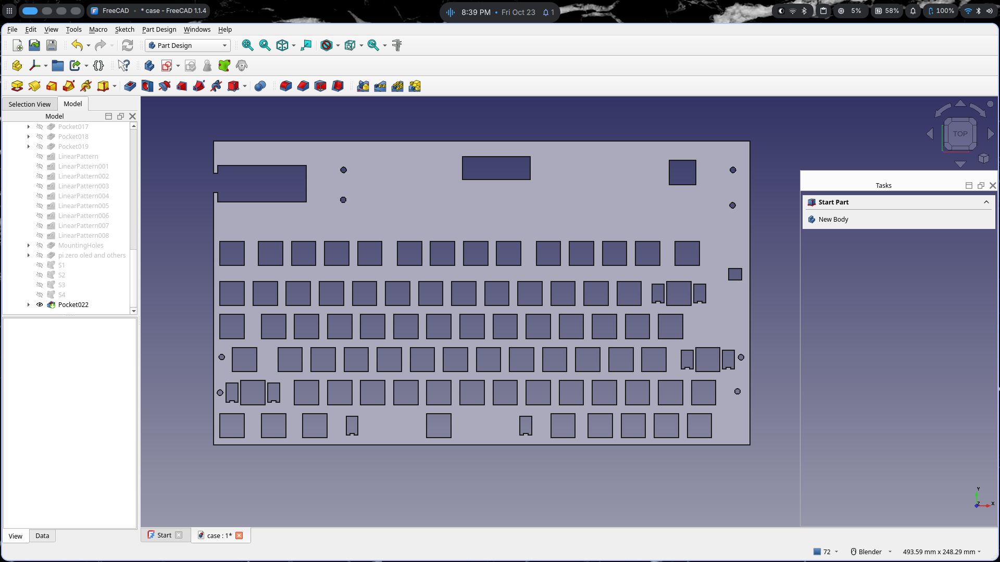

heres the pcb with the stabilizers 
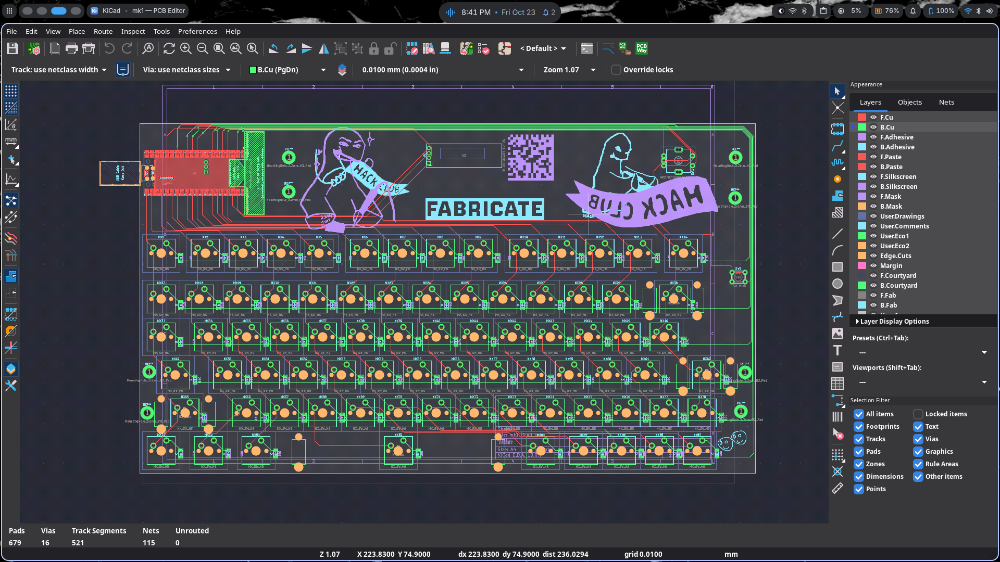
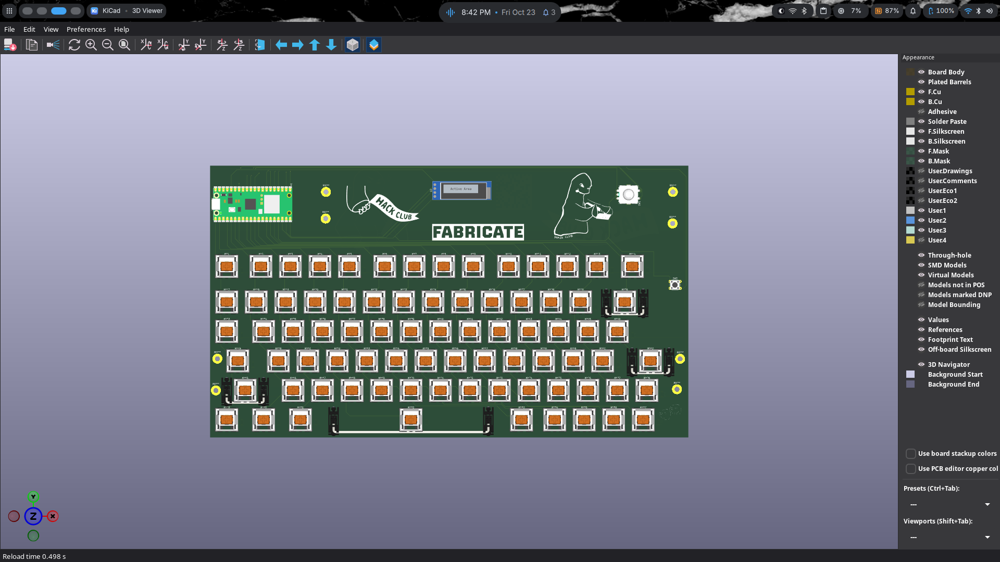

ok lets move on to the firmware now which should be the last part of this project before it is completed!

-- Day 11 [2026/10/24]
ok so last few touches before this proj is completed also it turns out i put an extra key in the 4th row so its a extra programmable key now ig although 
i wonder if that extra key is gonna affect the way i reach to the enter oh well i can program both to be enter by default my lazy ass doesnot wanna fix it 

ok anywyas im currently working on the firmware decided to go with qmk because their docs were quite easy to read 
the firmware part was kinda easier than i expected though it was tedious typing out the layout by hand im quite happy with the final 
product.
the firmware is still not finished tho ive only written the keyboard.json file i still need to finish keymaps tho. 
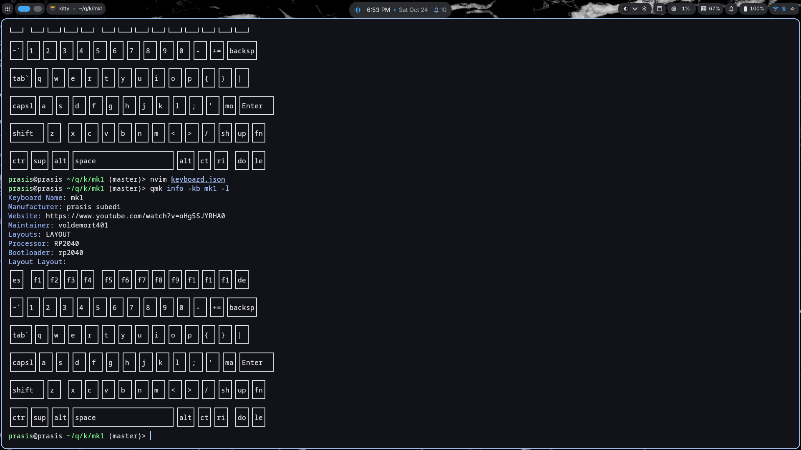

ok interesting tidbit as i was going through the docs i found this 
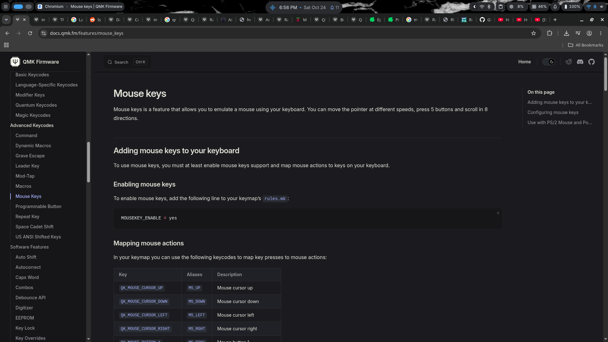

turns out i can actually emulate a mouse using my keyboard soooo you know the extra key ill try to make it so that on press it works as a enter 
key but on holding it will enable the mouse mode thing and you can browse using wasd thatll be neat lets see how i can actuall make that tho 

also i forgot to mention it but the layout is bascially copied from topre-realforce keyboard i liked the layout so i used it 
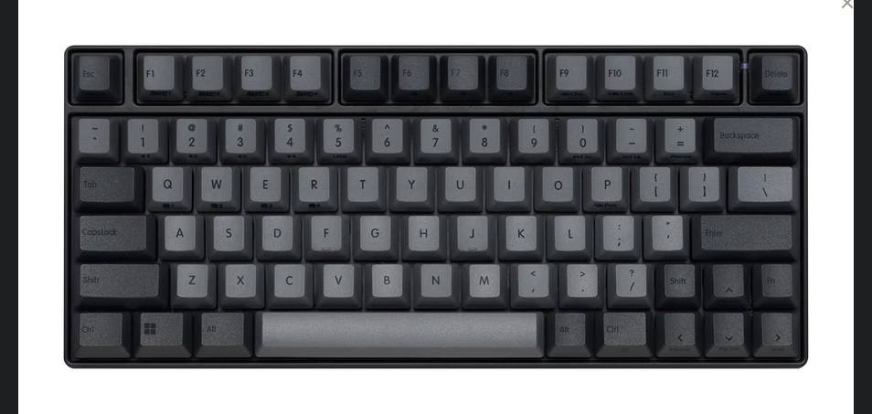

okkkk i managed to do it i think heres the layout  
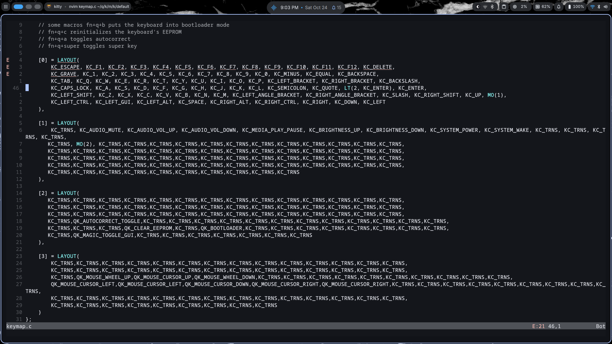

i think ive finished it now!! 
now before i go and make a BOM ill cleanup this folder because its a mess right now see ts 
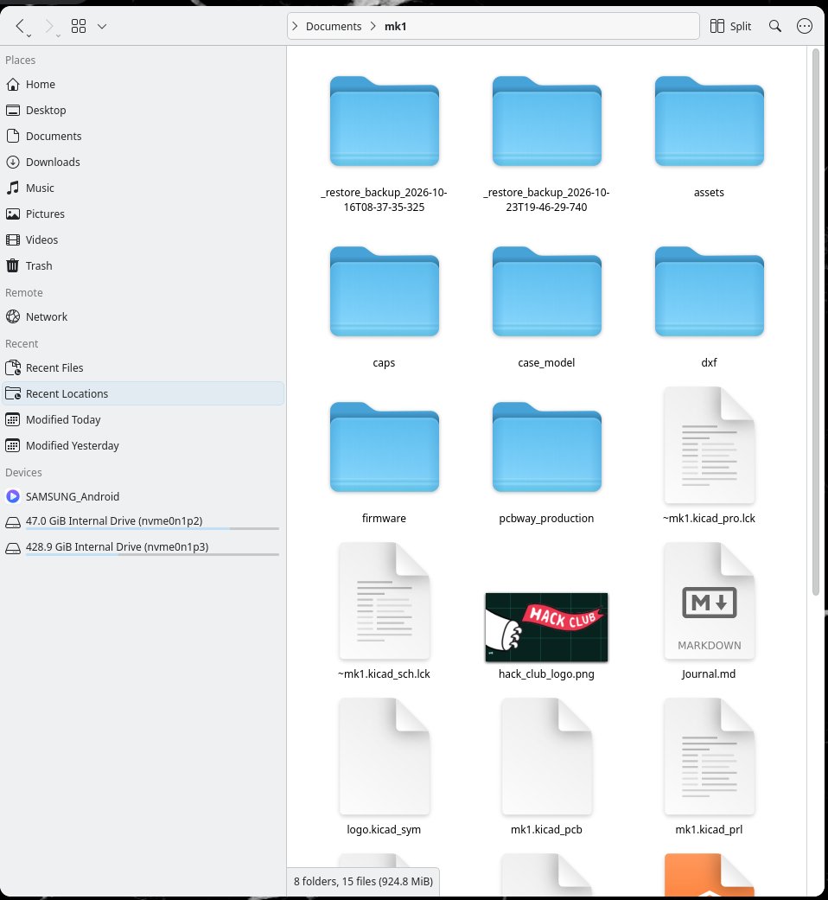

after that ill finally upload this in github and create the project in fabricate after that finally ill get to the BOM
